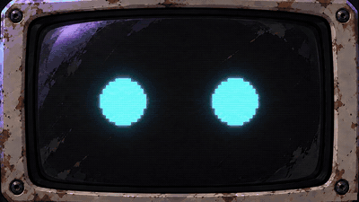
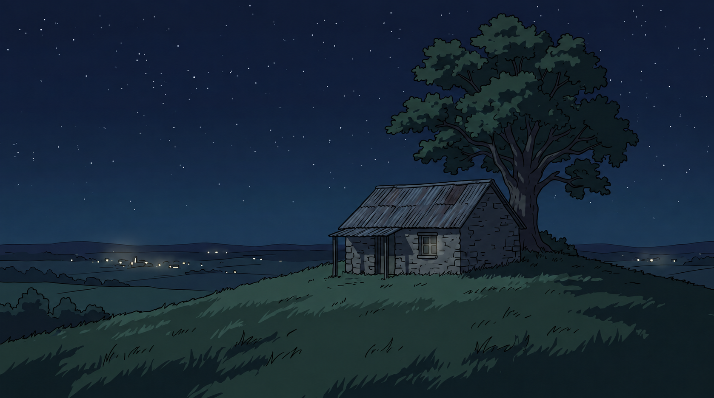
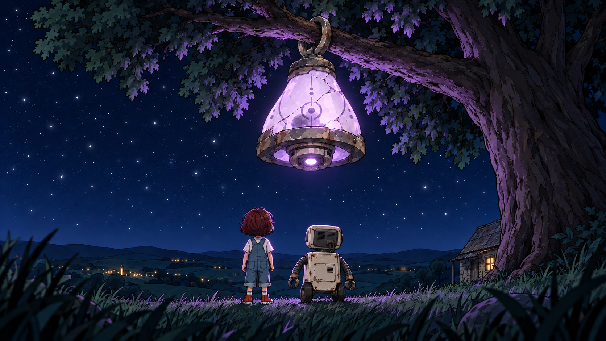
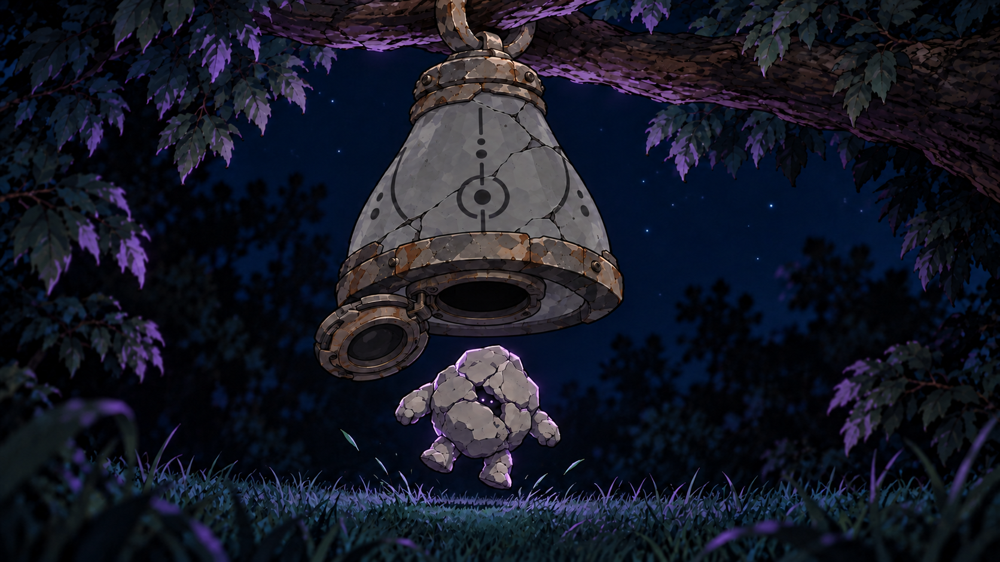
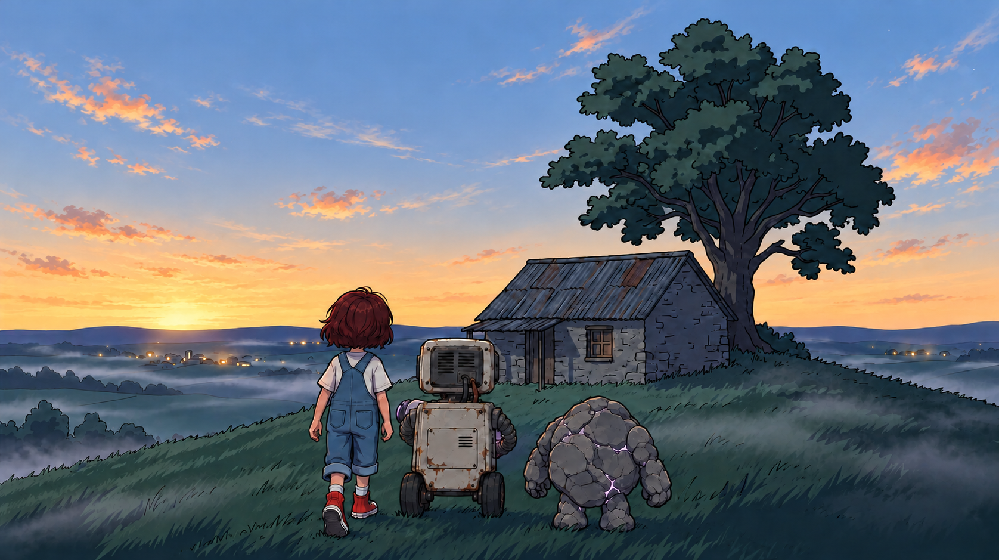

# Night Bloom | AI 생성 애니메이션 뮤직비디오

>**별이 가까운 언덕 끝의 집**
>
>**폐가전으로 만든 로봇과 사는 아이의 뒷마당에 우주선이 떨어진다.**

2026 제2회 AI·SW 창작 콘텐츠 공모전(숭실대 스파르탄AI교육원) 영상 부문 출품작.

- **영상**: [YouTube 영상 링크](https://www.youtube.com/watch?v=mrFbV311Eiw) · 2m 52s · 1080p
- 기간: 2026.10.15 ~ 10.24 (10일) · 1인

<br>

| 단계 | 도구 |
|---|---|
| 음악 | Mureka O2 |
| 이미지 | ChatGPT (GPT Astra Medium), Gemini (Nano Banana) |
| 영상 | Google Flow / Veo 3.1 Fast |
| 기획·프롬프트 설계·후처리 | Claude (Fable 5.1) |
| 편집 | DaVinci Resolve 21 |
  
- 총 제작비 약 ₩10,000 (Mureka 체험 $2 + Google AI Pro 학생 할인 ₩7,300)

<br>

<table>
  <tr>
    <td width="50%" align="center"></td>
    <td width="50%" align="center"></td>
  </tr>
  <tr>
    <td align="center">#11 빛을 받은 로봇의 눈</td>
    <td align="center">#6 아이와 로봇의 놀란 모습</td>
  </tr>
</table>

<p align="center">
     
</p>

<br>

## 파이프라인

```
곡 확정 (Mureka) → 음악 분석으로 싱크 포인트 결정 (librosa)
  → 7줄 시놉시스 → 36컷 스토리보드 (Claude)
  → 캐릭터·소품 시트 5장 (ChatGPT / Gemini)
  → 키프레임 37장 (ChatGPT / Gemini, 시트 첨부)
  → 이미지→영상 23컷 (Flow / Veo 3.1) + 정지 14컷
  → 워터마크 제거·업스케일·배속 (ffmpeg)
  → 편집·음악 싱크 (DaVinci Resolve)
```

<br>

## 설계에서 결정한 것들

### 일관성은 이미지 단계에서, 영상 단계는 유지만

영상 생성에 장면 묘사를 넣으면 넣을수록 캐릭터가 바뀌었다. 그래서 영상 프롬프트에는 `keep the exact line art, colors and character design of the input image` 한 줄과 움직임 하나만 쓰고, 그림체와 캐릭터는 전부 키프레임 단계에서 잡았다. 시트 5장을 매 컷 첨부하고, 같은 장소 컷은 앞 컷 결과를 다음 컷의 레퍼런스로 넘겼다. → [prompts-keyframes.md](docs/prompts-keyframes.md)

### 캐릭터 디자인 기준: 흔들려도 같은 대상으로 보일 것

생성 AI는 컷마다 디테일이 달라진다. 디테일이 아니라 실루엣과 색으로 구분되게 했다. 아이·상자 로봇·돌덩이·등불로 실루엣을 다르게, 각자 식별 요소 하나(헤드랜턴, 청록 눈, 틈 사이 빛, 젖빛 유리), 색은 흰·청록·연보라 셋만 쓰고 배경은 남색으로 눌렀다. → [storyline.md](docs/storyline.md#디자인)

### 빛의 이동이 줄거리

우주선의 연보라 빛이 엔진으로, 엔진이 로봇으로 옮겨 가고 로봇 눈이 청록에서 연보라로 바뀐다. 대사가 없으니 로봇 눈 색이 그 역할을 한다. 19번(로봇이 우주선에서 엔진을 꺼냄)과 31번(외계인이 로봇에 엔진을 넣음)은 같은 카메라 위치의 거울 구도로 짝지었다.

### 안 되는 동작은 빼고, 안 되는 컷은 정지로

걷기, 손 동작, 빛의 밝기 변화는 2~3번 돌려도 깨졌다. 계속 시도하는 대신 지시를 바꿨다. 발은 땅에 두고, 외계인은 움직이지 않고, 빛은 일정하게. 그래도 깨지는 컷은 정지 이미지에 느린 줌을 주는 쪽으로 돌렸다. 37컷 중 14컷이 그렇게 됐는데, 여백이 많은 연출을 노리니 딱히 어색하지 않았다. → [prompts-motion.md](docs/prompts-motion.md)

### 상태 변화는 Start+End 두 장으로

상태가 바뀌는 컷(눈 색 변화, 화면 켜짐·꺼짐)은 앞 상태와 뒤 상태를 각각 키프레임으로 만들어 Start·End에 넣었다.

### 소품은 글 대신 크롭 이미지로

엔진 크기가 컷마다 달라져서 "음료 캔 크기, 로봇 문보다 작게"를 써도 안 잡혔다. 19번 키프레임에서 엔진만 잘라낸 `ref_engine.png`를 만들어 이후 엔진이 나오는 모든 컷에 첨부했더니 고정됐다.

<br>

## 음악 싱크

`scripts/analyze_music.py`로 곡의 RMS와 드럼 에너지를 1초 단위로 계산해 싱크 포인트를 정했다.

| 시각 | 음악 | 컷 |
|---|---|---|
| 0:52~0:55 | 브레이크 (편집에서 1초 무음) | 우주선 빛 꺼짐 (12) |
| 0:55 | 드럼 강타 | 해치 열리며 외계인 낙하 (13) |
| 1:40 | 급락 | 로봇 멈춤 (23) |
| 2:05 | 복귀 | 외계인이 엔진 집음 (28) |

<br>

## 저장소 구성

```
docs/
  storyline.md          시놉시스, 연출 장치, 디자인, 복선
  storyboard.md         36컷 표 (시각·길이·행동·카메라·정지/영상)
  prompts-keyframes.md  키프레임 프롬프트 37컷 + 실패·수정 기록
  prompts-motion.md     영상 프롬프트 원칙 + Start/End 기법 + 실패 기록
  tool-selection.md     Flow vs Kling 비교, 비용
sheets/                 캐릭터 시트 5장 + ref_engine.png
keyframes/              최종 키프레임 37장 (11·23·32a는 start/end 2장)
scripts/
  analyze_music.py      librosa RMS·드럼 에너지 분석
  motion_prompts.csv    컷별 영상 프롬프트
  process_clips.sh      워터마크 제거·업스케일·배속·보간 일괄 처리
music/                  Night Bloom (Mureka)
```

최종 클립과 편집 프로젝트는 용량 때문에 저장소에 포함하지 않았다.

<br>

## 회고

- 스토리 논리 오류(세탁기 문 위치, 배터리 자리, 우주선이 매달렸다 바닥에 있다 다시 매달림, 낮 장면 없음)를 전부 생성 뒤에 발견했다. 스토리보드 단계에서 **소품 위치 타임라인**을 먼저 썼으면 재생성 10컷쯤 줄었을 것이다.
- 금지어(`no smoke`)는 우회된다(`steam`). 긍정문으로 상태를 서술하는 게(`the air is perfectly clear`) 더 잘 먹혔다.
- 모델이 아는 이름은 선입견을 끌어온다. `alien` → 외눈 클리셰. `rock creature`로 바꾸자 디자인이 유지됐다.
- 마지막 10%(줌·전환·합성)는 AI 대신 편집기에서 직접 하는 게 빨랐다.

<br>

## 타임라인

| 날짜 | 작업 |
|---|---|
| 10.15 | 공모전 선택, 7줄 시놉시스, 파이프라인·도구 조사 |
| 10.16 | 스토리라인 확정, 디자인 결정 |
| 10.17 | Mureka로 곡 생성·리믹스, 음악 분석, 36컷 스토리보드 |
| 10.18 | 캐릭터·소품 시트 5장 |
| 10.19~21 | 키프레임 37장 (핵심 연출 컷 먼저, 단독 컷 순서대로) |
| 10.21 | Flow·Kling 테스트, 영상 프롬프트 표 |
| 10.22~23 | 영상 23컷 생성, 후처리 스크립트 |
| 10.23~24 | DaVinci 편집, 내보내기, 제출 |
