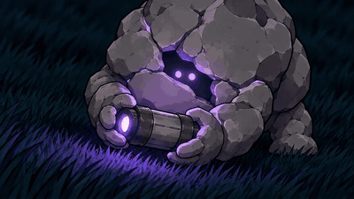
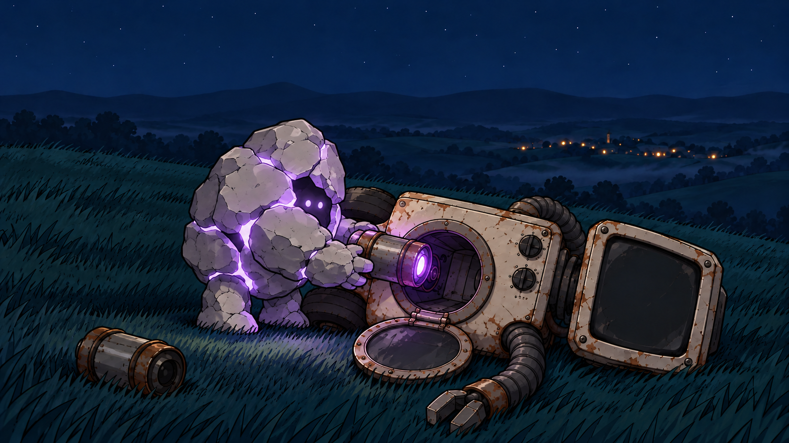
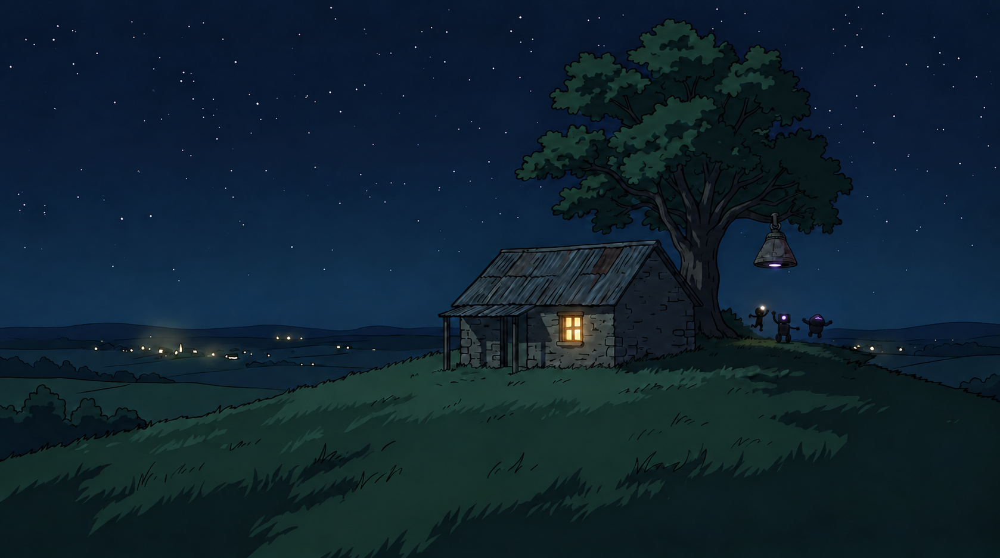

# Night Bloom — AI 생성 애니메이션 뮤직비디오

폐가전으로 만든 로봇과 사는 아이의 뒷마당에 우주선이 떨어진다. 셋이 우주선을 고치는 동안 멈추는 건 로봇이고, 외계인은 자기 우주선의 엔진을 빼서 로봇에게 끼워 준다. 대사 없이 음악과 그림만으로 2분 52초.

2026 제2회 AI·SW 창작 콘텐츠 공모전(숭실대 스파르탄AI교육원) 영상 부문 출품작.

- **영상**: [YouTube (일부공개)](YOUTUBE_LINK)
- 기간: 2026.10.15 ~ 10.24 (10일) · 1인
- 도구: Mureka O2(음악) · ChatGPT GPT Astra Medium, Gemini Nano Banana(이미지) · Google Flow / Veo 3.1 Fast(영상) · Claude Fable 5.1(기획·프롬프트 설계·후처리 스크립트) · DaVinci Resolve 21(편집)
- 총 제작비 약 ₩10,000 (Mureka 체험 $2 + Google AI Pro 학생 할인 ₩7,300)

<table>
  <tr>
    <td width="50%" align="center"></td>
    <td width="50%" align="center"></td>
  </tr>
  <tr>
    <td align="center">11 — 로봇 눈이 우주선 빛에 동조 (Start+End 프레임)</td>
    <td align="center">28 — 외계인이 엔진을 집어 듦 (2:05 음악 복귀)</td>
  </tr>
</table>

<p align="center">
     
</p>

## 파이프라인

```
곡 확정 (Mureka) → 음악 분석으로 싱크 포인트 결정 (librosa)
  → 7줄 시놉시스 → 36컷 스토리보드 (Claude)
  → 캐릭터·소품 시트 5장 (ChatGPT / Gemini)
  → 키프레임 37장 (ChatGPT / Gemini, 시트 첨부)
  → 이미지→영상 23컷 (Flow / Veo 3.1) + 정지 14컷
  → 워터마크 제거·업스케일·배속 (ffmpeg)
  → 편집·음악 싱크 (DaVinci Resolve)
```

곡을 먼저 확정하고 그 타임라인에 컷을 맞췄다. 영상 생성 AI는 8초 단위라 3분은 36컷이고, 컷마다 "움직임 하나"만 시키는 게 일관성을 지키는 유일한 방법이었다.

## 설계에서 결정한 것들

**키프레임 단계에서 품질을 다 잡고, 영상 단계는 "유지"만 시켰다.** 영상 프롬프트에 장면 묘사를 다시 쓰지 않고 `keep the exact line art, colors and character design of the input image`만 반복했다. 그림체·캐릭터 일관성은 전부 이미지 단계의 시트 첨부와 레퍼런스 체인(앞 컷 결과를 다음 컷에 첨부)으로 해결했다. → [docs/prompts-keyframes.md](docs/prompts-keyframes.md)

**캐릭터는 생성 AI가 흔들려도 같은 대상으로 보이게 설계했다.** 실루엣을 서로 다르게(아이·상자 로봇·돌덩이·등불), 각자 고정 식별 요소 하나(헤드랜턴·청록 눈·틈 사이 빛·젖빛 유리), 색은 흰·청록·연보라 셋만. 배경은 남색으로 눌러 세 빛만 튀게. → [docs/storyline.md](docs/storyline.md#디자인)

**빛이 이야기를 끌고 간다.** 우주선의 연보라 빛이 엔진으로, 엔진이 로봇으로 옮겨 가고, 로봇 눈이 청록에서 연보라로 바뀐다. 로봇 눈 색이 유일한 "대사"다. 19번(로봇이 우주선에서 엔진을 꺼냄)과 31번(외계인이 로봇에 엔진을 넣음)은 같은 카메라의 거울 구도.

**AI가 못하는 동작은 시키지 않았다.** 걷기·손 동작·빛 변화는 재시도 2~3회 안에 깨지는 걸 확인하고 지시 자체를 바꿨다 — "발은 땅에", "외계인은 정지", "빛은 일정". 그래도 깨지는 컷은 정지 이미지에 느린 줌을 주는 쪽으로 전환했다(37컷 중 14컷). 지브리식 "머무는 컷"이라 정지가 오히려 자연스러웠다. → [docs/prompts-motion.md](docs/prompts-motion.md)

**상태와 변화를 구분했다.** 키프레임은 "결과 상태"인데 프롬프트가 "변화 과정"을 시키면 모델이 없는 걸 지어낸다(꺼진 우주선에 "빛이 꺼진다"를 주자 빛·렌즈·실루엣이 생김). 상태가 바뀌는 컷은 Start+End 두 장으로 넣었다.

**소품은 말 대신 그림으로 고정했다.** 엔진 크기가 컷마다 틀어지자 19번 키프레임에서 엔진만 잘라낸 `ref_engine.png`를 만들어 이후 모든 컷에 첨부했다.

## 음악 싱크

`scripts/analyze_music.py`로 곡의 RMS와 드럼 에너지를 1초 단위로 계산해 싱크 포인트를 정했다.

| 시각 | 음악 | 컷 |
|---|---|---|
| 0:52~0:55 | 브레이크 (편집에서 1초 무음) | 우주선 빛 꺼짐 (12) |
| 0:55 | 드럼 강타 | 해치 열리며 외계인 낙하 (13) |
| 1:40 | 급락 | 로봇 멈춤 (23) |
| 2:05 | 복귀 | 외계인이 엔진 집음 (28) |

## 저장소 구성

```
docs/
  storyline.md          시놉시스, 연출 장치, 디자인, 복선
  storyboard.md         36컷 표 (시각·길이·행동·카메라·정지/영상)
  prompts-keyframes.md  키프레임 프롬프트 37컷 + 실패·수정 기록
  prompts-motion.md     영상 프롬프트 원칙 + Start/End 기법 + 실패 기록
  tool-selection.md     Flow vs Kling 비교, 비용
sheets/                 캐릭터 시트 5장 + ref_engine.png
keyframes/              최종 키프레임 37장 (11·23·32a는 start/end 2장)
scripts/
  analyze_music.py      librosa RMS·드럼 에너지 분석
  motion_prompts.csv    컷별 영상 프롬프트
  process_clips.sh      워터마크 제거·업스케일·배속·보간 일괄 처리
music/                  Night Bloom (Mureka)
```

최종 클립과 편집 프로젝트는 용량 때문에 저장소에 포함하지 않았다.

## 회고

- 스토리 논리 오류(세탁기 문 위치, 배터리 자리, 우주선이 매달렸다 바닥에 있다 다시 매달림, 낮 장면 없음)를 전부 생성 뒤에 발견했다. 스토리보드 단계에서 **소품 위치 타임라인**을 먼저 썼으면 재생성 10컷쯤 줄었을 것이다.
- 금지어(`no smoke`)는 우회된다(`steam`). 긍정문으로 상태를 서술하는 게(`the air is perfectly clear`) 더 잘 먹혔다.
- 모델이 아는 이름은 선입견을 끌어온다. `alien` → 외눈 클리셰. `rock creature`로 바꾸자 디자인이 유지됐다.
- 마지막 10%(줌·전환·합성)는 AI 대신 편집기에서 직접 하는 게 빨랐다.

## 타임라인

| 날짜 | 한 것 |
|---|---|
| 10.15 | 공모전 선택, 7줄 시놉시스, 파이프라인·도구 조사 |
| 10.16 | 스토리라인 확정, 디자인 결정 |
| 10.17 | Mureka로 곡 생성·리믹스, 음악 분석, 36컷 스토리보드 |
| 10.18 | 캐릭터·소품 시트 5장 |
| 10.19~21 | 키프레임 37장 (핵심 연출 컷 먼저, 단독 컷 순서대로) |
| 10.21 | Flow·Kling 테스트, 영상 프롬프트 표 |
| 10.22~23 | 영상 23컷 생성, 후처리 스크립트 |
| 10.23~24 | DaVinci 편집, 내보내기, 제출 |
